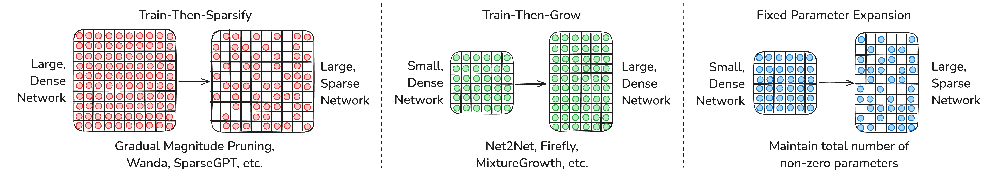

# ['Expand Neurons, Not Parameters'](https://openreview.net/forum?id=cYxavyv2C7) - ICML 2026
Here we include the code for our paper [Expand Neurons, Not Parameters](https://openreview.net/forum?id=cYxavyv2C7).

### Overview



Paradigms of parameter efficiency in training and inference. ''Train-then-sparsify'' minimizes post-training inference cost, at the expense of training a large, dense model initially and of sparse fine-tuning. ''Train-then-grow'' amortizes some training cost via bootstrapping from a small, dense network, to yield a large, dense network that is more expensive to inference, though some techniques are constrained by final size. Here, we show theoretical justification and empirical feasibility of directly splitting neurons within a small, dense network into a large, sparse one.

### Environment setup

Create a conda environment (installs PyTorch, torchvision, and all Python dependencies):
```
conda env create -f environment.yml
conda activate expand-neurons
```

For a pip-only install, install PyTorch matching your CUDA version (see [pytorch.org](https://pytorch.org)), then:
```
pip install -r requirements.txt
```

### Running the examples

Four example scripts in `examples/`. Each one trains a baseline model for 50 epochs, then trains an Fixed Parameter Expansion model on the same parameter budget after splitting at epoch 25, and prints a final comparison of best test accuracy.

```
python examples/boolean_example.py         # synthetic k-DNF on MLP with embedding layer
python examples/fashion_mnist_example.py   # FashionMNIST on MLP
python examples/cifar_100_clip_example.py  # CIFAR-100 CLIP embeddings on MLP
python examples/cifar_100_cnn_example.py   # CIFAR-100 on MLP with CNN backbone
```

First-run downloads land in `./data/`. The CLIP example caches its embeddings to `./data/CIFAR100_clip_embeddings.pkl` so subsequent runs skip the CLIP forward pass entirely.

### Cite
If you found our work useful, please cite our paper:
```
@inproceedings{kong2026expand,
  title={Expand Neurons, Not Parameters},
  author={Kong, Linghao and Subramanian, Inimai and Shavit, Yonadav G, and Adler, Micah and Alistarh, Dan and Shavit, Nir N},
  booktitle={The Forty-third International Conference on Machine Learning}
}
```